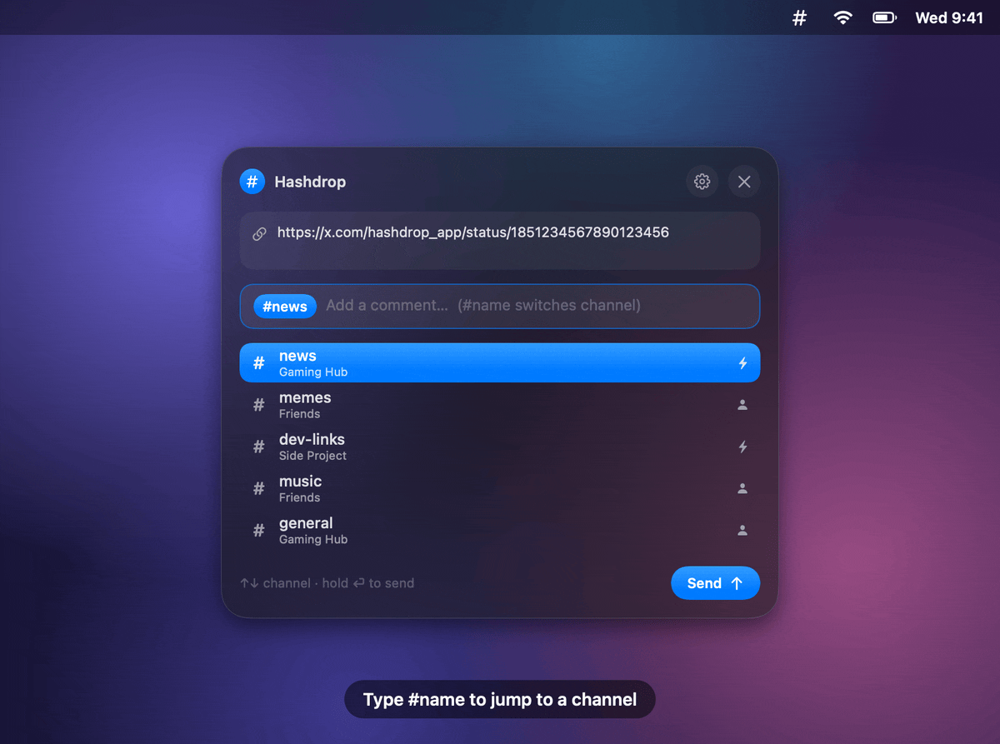
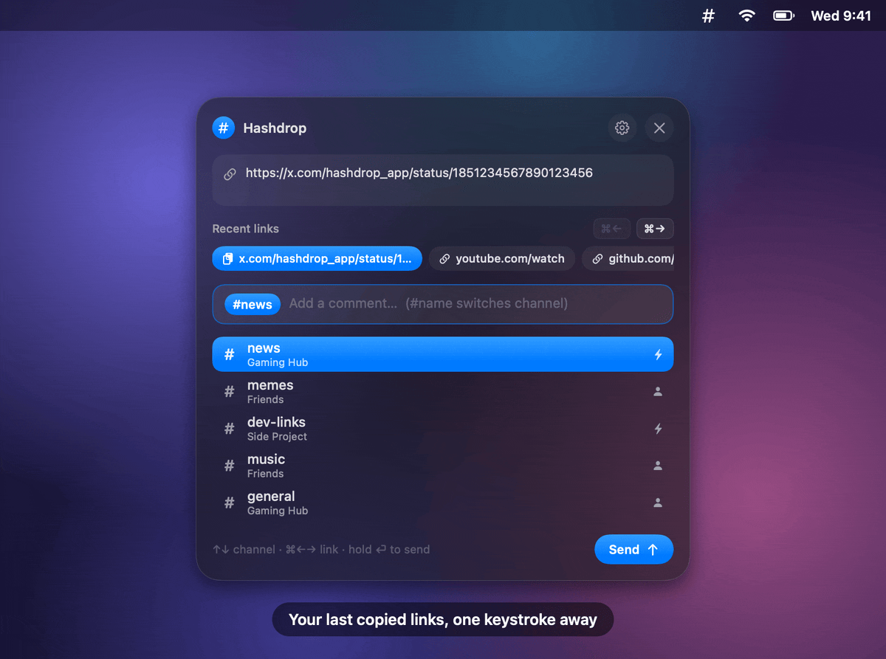
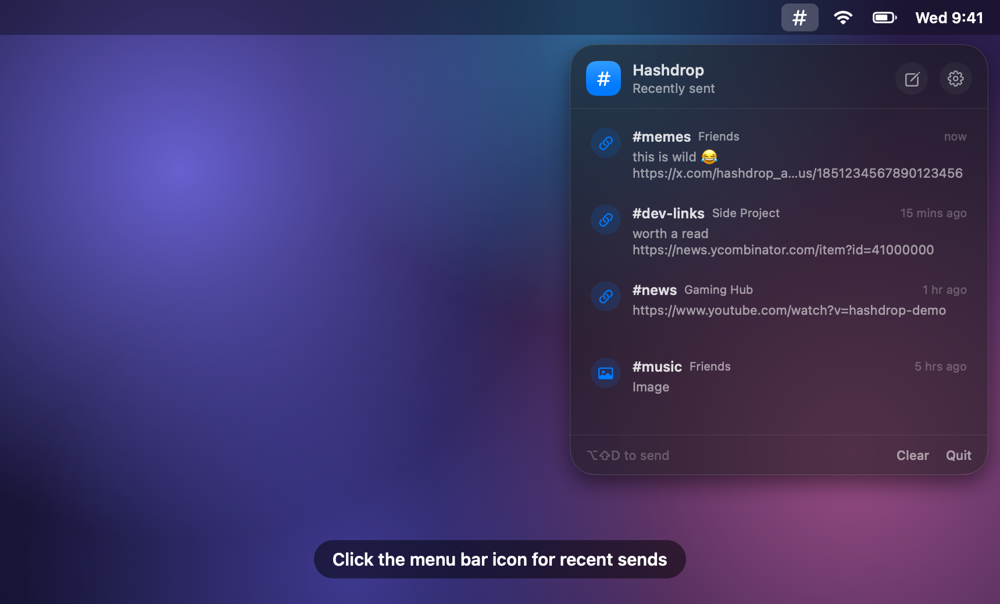

<p align="center">
  
</p>

<h1 align="center">Hashdrop</h1>

<p align="center">
  <b>Drop links into your channels from anywhere on your Mac.</b><br>
  Copy → <kbd>⌥</kbd><kbd>⇧</kbd><kbd>D</kbd> → pick a channel → hold <kbd>⏎</kbd>. No tab switching, no hunting for the channel.
</p>

<p align="center">
  <a href="https://github.com/gorkemblm/Hashdrop/releases/latest"></a>
  
  <a href="LICENSE"></a>
  <a href="#works-with"></a>
</p>

<p align="center">
  <a href="https://github.com/gorkemblm/Hashdrop/releases/latest/download/Hashdrop.dmg"></a>
</p>

<p align="center">
  
</p>

## Why

Sharing something you found on X, YouTube or anywhere else to a group chat usually means: copy, switch apps, find the right server or workspace, find the channel, paste, type, switch back. Hashdrop turns that into one shortcut and a small floating panel, then puts you right back where you were.

## Works with

| | Platform | Status |
|---|---|---|
|  | **Discord** | ✅ Supported: webhooks and the Discord desktop app |
| 🔌 | Other webhook-based apps | Planned. Hashdrop is built around channels and webhooks, not one service. [Suggest one](https://github.com/gorkemblm/Hashdrop/issues) |

## Features

- **One shortcut, anywhere.** A Spotlight-style panel opens over whatever you're doing.
- **Pick the channel with ↑↓** — most recently used first — or type `#name` to jump straight to one.
- **Optional comment** sent together with the link.
- **Hold ⏎ to send.** A quick tap never posts by accident.
- **Recent links.** The last 10 links you copied are one keystroke away (<kbd>⌘←</kbd> / <kbd>⌘→</kbd>).
- **Two ways to post to Discord**, per channel:
  - **Discord webhook**: silent and in the background, for servers you manage.
  - **Discord app**: works in any server and posts as your own account.
- **Recent sends** in the menu bar, with a sound and a small toast when something goes out.
- Images on the clipboard work too. Native, tiny, no Electron, no account, no tracking.

## Install

1. **[Download Hashdrop.dmg](https://github.com/gorkemblm/Hashdrop/releases/latest/download/Hashdrop.dmg)**. It's the latest version, signed and notarized by Apple. Older versions and release notes are on the [Releases](https://github.com/gorkemblm/Hashdrop/releases) page.
2. Drag **Hashdrop** to **Applications** and open it. A `#` icon appears in the menu bar and Settings opens.
3. Add your channels (below). Optionally turn on **Open at login** in Settings → General.

Requires macOS 14 Sonoma or later (Apple Silicon or Intel). On macOS 26 the panels use Liquid Glass.

> Prefer to build it yourself? See [Building from source](#building-from-source).

## Add channels

Open Settings (menu bar icon → ⚙) → **Channels** → **+**. Give it a name, then choose how it sends:

|  | **Discord webhook** | **Discord app** |
|---|---|---|
| Works in | Servers where you can *Manage Webhooks* | Any channel you can post in |
| Posts as | The webhook's name and avatar (set them to yours) | Your own account |
| Discord window | Never opens | Comes forward for a moment, then you're switched back |
| Needs | Nothing else | Discord desktop app (signed in) + Accessibility permission |

### Discord webhook

1. In Discord, hover the channel → ⚙ **Edit Channel** → **Integrations** → **Webhooks** → **New Webhook**.
2. Optionally set its name and avatar to your own, then **Copy Webhook URL** and **Save**.
3. Paste the URL into Hashdrop and press **Send test message**.

Treat the webhook URL like a password: anyone who has it can post to that channel. If it leaks, delete the webhook in Discord and create a new one.

### Discord app

1. In Discord, right-click the channel name in the sidebar → **Copy Link**. It looks like `https://discord.com/channels/…/…`. An invite link (`discord.gg/…`) won't work.
2. Paste it into Hashdrop.
3. The first time you send, macOS asks for **Accessibility** permission, so that first send doesn't go through. Enable Hashdrop under System Settings → Privacy & Security → Accessibility, then send again. Hashdrop needs this permission to paste and press Return in Discord for you.

Hashdrop opens the channel through Discord's own `discord://` link, pastes, presses Return, restores your clipboard and switches back. Don't type during that second, or your keystrokes go to Discord too. If a message lands before the channel has loaded, raise **Wait for channel to load** in Settings → General.

## Using it

| Key | Action |
|---|---|
| <kbd>⌥</kbd><kbd>⇧</kbd><kbd>D</kbd> | Open the panel (change it in Settings → General) |
| <kbd>↑</kbd> <kbd>↓</kbd> | Choose the channel |
| `#name` then <kbd>⏎</kbd> or space | Jump to a channel by name |
| type | Add a comment (optional) |
| hold <kbd>⏎</kbd> | Send (or click **Send** / press <kbd>⌘⏎</kbd>) |
| <kbd>⌘←</kbd> <kbd>⌘→</kbd> | Switch between the clipboard and recently copied links (modifier is configurable) |
| <kbd>esc</kbd> | Close |

Start a comment with `##` if it should begin with a literal `#`.

<p align="center">
  
  
</p>

Click the menu bar icon for everything you've sent recently. Click an entry to open its link, right-click to copy or remove it.

<p align="center">
  
</p>

## Privacy & security

- **No Discord token, no self-bot.** Hashdrop never asks for or reads your Discord login. It uses webhooks you create, or it does a paste and Return in the official Discord app, and you trigger every send yourself.
- **Everything stays on your Mac.** Hashdrop talks to nothing but the Discord webhooks you configure. There's no analytics and no account.
- **Settings** live in `~/Library/Application Support/Hashdrop/settings.json`, readable only by you, because they contain webhook URLs. Your send history sits next to it in `history.json`. **Clear** in the menu bar panel wipes both the send history and the recently copied links.
- **Recent links are kept in memory only** and are gone when you quit. Only single `http(s)` links are remembered. Anything a password manager marks as concealed is ignored, as is anything copied while a password manager (1Password, Bitwarden, Passwords, Keychain Access, KeePassXC, Enpass or Dashlane) is in front. You can turn the feature off in Settings → General.
- **Mentions are disabled** on webhook posts, so a pasted `@everyone` never pings anyone. Discord-app sends behave exactly as if you had typed the message yourself.

## Troubleshooting

<details>
<summary><b>The shortcut does nothing</b></summary>

Another app may already use <kbd>⌥</kbd><kbd>⇧</kbd><kbd>D</kbd>; Hashdrop shows a warning if it can't register it. Pick a different shortcut in Settings → General.
</details>

<details>
<summary><b>"Discord app" channels don't send, or land in the wrong channel</b></summary>

- Make sure Hashdrop is enabled under System Settings → Privacy & Security → Accessibility. After an update you may need to toggle it off and on again.
- Increase **Wait for channel to load** in Settings → General.
- If Discord wasn't running, the first send waits for it to start. That can take a while.
</details>

<details>
<summary><b>Webhook test fails with 401 / 404</b></summary>

The URL was copied incompletely, or the webhook was deleted. Copy it again from the channel's Integrations settings.
</details>

## Uninstall

Quit Hashdrop from the menu bar panel and delete it from Applications. To remove its data too, delete `~/Library/Application Support/Hashdrop`, and remove Hashdrop from System Settings → Privacy & Security → Accessibility.

## Building from source

Requires Xcode 26 (Swift 6.2, macOS 26 SDK). The app still runs on macOS 14+.

```sh
git clone https://github.com/gorkemblm/Hashdrop.git
cd Hashdrop
./scripts/build-app.sh          # → build/Hashdrop.app (universal)
open build/Hashdrop.app
```

`ARCHS=arm64 ./scripts/build-app.sh` builds only for Apple Silicon, which is faster. The script signs with your Developer ID or Apple Development certificate if it finds one, and ad-hoc otherwise. With ad-hoc signing, macOS forgets the Accessibility permission on every rebuild.

<details>
<summary><b>Maintainer notes</b></summary>

- **Release:** `VERSION=1.0.0 ./scripts/release.sh` builds, signs with Developer ID, notarizes and staples `build/Hashdrop-1.0.0.dmg`. One-time setup steps are at the top of the script.
- **Demo images:** `./scripts/make-demo.sh` re-renders the GIFs and screenshots in `docs/` from the real SwiftUI views with made-up channels (needs `brew install gifski`).
- **App icon:** `swift scripts/make-icon.swift` regenerates `Resources/AppIcon.icns`.
</details>

### Project layout

| Path | What |
|---|---|
| `Sources/Hashdrop/AppController.swift` | Menu bar item, global shortcut, panels, sending flow |
| `Sources/Hashdrop/ComposerView.swift` | The send panel |
| `Sources/Hashdrop/History.swift` | Recent sends panel and storage |
| `Sources/Hashdrop/Senders.swift` | Webhook and Discord-app delivery |
| `Sources/Hashdrop/ClipboardWatcher.swift` | Recent links (in memory) |
| `Sources/Hashdrop/SettingsView.swift` | Settings window |
| `Sources/Hashdrop/DemoRenderer.swift` | Renders the README GIFs |

## Disclaimer

Hashdrop is an independent project and is not affiliated with, endorsed by or sponsored by Discord Inc. "Discord" is a trademark of Discord Inc.

## License

[MIT](LICENSE) © 2026 Gorkem Bilim
